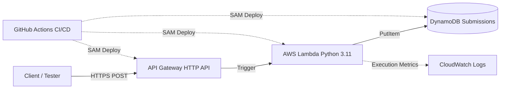
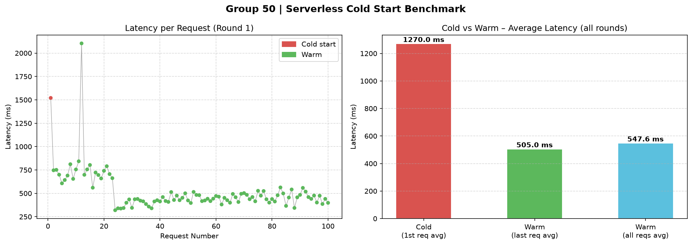

# Serverless Cold Start & Cost Economics Analysis

> **Cloud Computing Project — Group 50**  
> **Theme 4**: Serverless & Startups (Freshworks Case Study)  
> **Region**: AWS Asia Pacific Mumbai (`ap-south-1`)

---

## 1. Title & Overview

This project provides an empirical investigation into **AWS Serverless performance, cold start latencies, and cloud unit economics** tailored for early-stage startups and modern engineering workflows (such as Freshworks and Shaadi.com).

Serverless architectures (AWS Lambda + Amazon API Gateway + Amazon DynamoDB) eliminate idle compute costs by scaling to zero when inactive. However, intermittent traffic triggers **cold starts**—ephemeral microVM instantiation (AWS Firecracker), runtime bootstrap, and dependency loading. 

Using a custom 500-request benchmarking matrix and AWS CloudWatch Logs Insights across 545 invocations, we quantified the cold-start penalty, isolated physical network latency from pure container execution, and built a comprehensive cost comparison against always-on Amazon EC2 virtual machines.

---

## 2. Architecture Diagram

The end-to-end system is fully managed as code via AWS SAM and deployed through GitHub Actions:



### Architectural Highlights
- **API Gateway (HTTP API)**: Regional endpoint in `ap-south-1` offering sub-millisecond API routing, CORS preflight handling, and direct proxy integration with Lambda.
- **AWS Lambda (Python 3.11)**: Ephemeral compute handler allocated 128 MB RAM, executing in an isolated Firecracker microVM container with IAM least-privilege permissions.
- **Amazon DynamoDB**: Schema-less On-Demand NoSQL table storing inbound submissions without capacity planning or provisioning constraints.
- **Amazon CloudWatch**: High-granularity log stream capturing real-time `@duration`, `@billedDuration`, and `@initDuration` metrics.

---

## 3. Live API URL & Verification

The serverless backend is live in production in AWS Mumbai (`ap-south-1`).

### Live Endpoint
```http
POST https://w3obh27tnh.execute-api.ap-south-1.amazonaws.com/submit
Content-Type: application/json
```

### Quick Test Commands

#### PowerShell:
```powershell
Invoke-RestMethod -Method Post `
  -Uri "https://w3obh27tnh.execute-api.ap-south-1.amazonaws.com/submit" `
  -ContentType "application/json" `
  -Body '{"name":"test","score":9.5}'
```

#### cURL (Bash / Linux / macOS):
```bash
curl -X POST https://w3obh27tnh.execute-api.ap-south-1.amazonaws.com/submit \
  -H "Content-Type: application/json" \
  -d '{"name":"test","score":9.5}'
```

#### Expected 200 OK Response:
```json
{
  "message": "Submission stored successfully",
  "id": "e98e4d3f-56f8-4e8c-8f12-085734bc1a42",
  "name": "test",
  "score": 9.5
}
```

---

## 4. Repository Structure

```text
Cloud_Computing_Group_50_Freshworks/
├── README.md                               # Comprehensive Project Documentation
├── docs/                                   # Project Documentation & Deliverables
│   ├── make_cost.py                        # Automated Cost Analysis Generator
│   ├── generate_ppt.py                     # PowerPoint Presentation Generator
│   ├── Cloud_Computing_Group_50_Presentation.pptx # 10-Slide Final Deck
│   ├── presentation.md                     # Presentation Slides & Speaker Notes
│   └── final_report.md                     # Complete Technical & Economics Report
├── results/                                # Root Deliverables
│   ├── cost.xlsx                           # Cost Model & Break-Even Spreadsheet
│   └── latency_graph.png                   # 500-Request Production Latency Chart
└── serverless-coldstart/                   # SAM Project & Infrastructure Code
    ├── template.yaml                       # AWS SAM Infrastructure as Code (IaC)
    ├── .gitignore                          # Build & Artifact Exclusions
    ├── .github/
    │   └── workflows/
    │       └── deploy.yml                  # Automated SAM Build & Deploy Workflow
    ├── lambda/
    │   └── lambda_function.py              # Python 3.11 Lambda Ingestion Handler
    ├── benchmark/
    │   ├── benchmark.py                    # 5x100 Matrix Benchmark Engine
    │   └── analyze.py                      # Data Aggregation & Plotting Utility
    └── results/
        ├── cost.xlsx                       # Synchronized Cost Analysis Sheet
        ├── latency.csv                     # Raw Millisecond Data (500 Requests)
        ├── summary.csv                     # Statistical Summary (Cold vs Warm)
        ├── latency_analysis.xlsx           # Excel Statistical Workbook
        ├── latency_graph.png               # High-Resolution Latency Chart
        ├── cloudwatch_reports.txt          # CloudWatch Insights Raw Log Dumps
        └── screenshots/                    # Verification Screenshots
```

---

## 5. Deployment Guide

The infrastructure is 100% reproducible using **AWS SAM** (Serverless Application Model).

### Prerequisites
- Python 3.11+
- AWS CLI configured with valid credentials (`aws configure`)
- AWS SAM CLI installed (`sam --version`)

### Manual Deployment
```bash
cd serverless-coldstart

# 1. Validate SAM template
sam validate

# 2. Build deployment artifacts
sam build

# 3. Deploy to AWS ap-south-1
sam deploy --guided
```

### Automated CI/CD Deployment
Any commit pushed to the `main` branch automatically triggers the GitHub Actions workflow in `.github/workflows/deploy.yml`. It sets up Python, installs the AWS SAM CLI, configures AWS credentials, and runs:
```bash
sam build
sam deploy --no-confirm-changeset
```

---

## 6. Benchmark Results & Latency Analysis

### Empirical Performance Summary (500 Requests)

Data collected from `results/summary.csv` and 5 testing rounds:

| Performance Metric | Measured Value | Operational Interpretation |
| :--- | :---: | :--- |
| **Cold Start Latency (1st request avg)** | **1,270.01 ms** | Latency on container cold boot |
| **Warm Latency (100th request avg)** | **504.98 ms** | Stabilized latency on hot container |
| **Warm Latency (Overall warm avg)** | **547.59 ms** | Average across all warm requests (req 2–100) |
| **Warm 95th Percentile (p95)** | **792.55 ms** | Strict tail latency for 95% of warm calls |
| **Cold-to-Warm Ratio** | **2.32x slower** | Initial user experiences a 2.32x latency penalty |

### Production Latency Chart

The benchmark chart below illustrates the dramatic spike on the initial cold start request across all 5 test rounds, followed by instantaneous convergence into a tight, consistent warm execution band:



---

## 7. Cost Analysis & EC2 Break-Even Comparison

Detailed calculations are generated via `docs/make_cost.py` and saved to `results/cost.xlsx`.

### 7.1 Serverless Cost Breakdown (per 1,000 Requests)

Based on AWS pricing in Mumbai (`ap-south-1`):

| Cost Component | Unit Rate | Cost per 1,000 Requests |
| :--- | :--- | :---: |
| **API Gateway (HTTP API)** | \$1.00 / million calls | **\$0.00100** |
| **Amazon DynamoDB (On-Demand Write)** | \$1.25 / million writes | **\$0.00125** |
| **AWS Lambda Invocations** | \$0.20 / million requests | **\$0.00020** |
| **AWS Lambda Compute** | 33.39 ms @ 128 MB RAM (\$0.0000166667 / GB-s) | **\$0.00007** |
| **TOTAL PER 1,000 REQUESTS** | — | **\$0.00252** |

> **Key Takeaway**: 1,000 serverless requests cost approximately **\$0.00252** (roughly a quarter of one US cent).

### 7.2 Always-On EC2 Comparison (`t3.micro`)

- **Instance Type**: `t3.micro` (2 vCPU, 1 GB RAM, Linux)
- **Hourly Rate in `ap-south-1`**: \$0.0104 / hour
- **Monthly Fixed Cost (24/7)**:
  $$\$0.0104 \times 730 \text{ hours} = \mathbf{\$7.59 \text{ per month}}$$

### 7.3 Break-Even Analysis

$$\text{Break-Even Threshold} = \frac{\$7.59}{\$0.00252 / 1,000} \approx \mathbf{3,010,000 \text{ requests / month}}$$

- **Traffic < 3.01 Million requests/month**: Serverless is **significantly cheaper** and scales to \$0 when traffic ceases.
- **Traffic > 3.01 Million requests/month**: Sustained steady-state traffic may justify containerized workloads on EC2 or ECS Fargate, provided engineering overhead is accounted for.

---

## 8. Cold Start Technical Breakdown & Mitigations

### Why Cold Starts Occur
CloudWatch Logs Insights across 545 production invocations reveals:
- **Average Pure Code Execution**: **25.39 ms**
- **Average Init Duration (Cold Boot)**: **455.87 ms**
- **Average Billed Duration**: **33.39 ms**

#### Dissecting the Latency Gap:
1. **Container & MicroVM Provisioning (AWS Firecracker)**: Allocates CPU and memory slices, setting up network interfaces (~200–300 ms).
2. **Runtime & SDK Initialization**: Boots the Python 3.11 runtime and loads heavy libraries like `boto3` (~150–250 ms).
3. **Physical WAN Network Transit**: Client-to-Mumbai network round-trip accounting for ~500–520 ms of the total perceived end-to-end response.

### Industry Mitigation Strategies (Freshworks & Shaadi.com)
1. **Provisioned Concurrency**: Keeps a pre-allocated pool of warm containers ready to serve traffic with zero init duration for critical endpoints.
2. **Lean Dependencies**: Import only necessary client classes (e.g., `from boto3 import client` instead of importing monolithic SDKs) to reduce memory and cold init duration.
3. **Scheduled Warming Pings**: Use Amazon EventBridge cron rules (every 5 minutes) to keep execution environments active during expected business hours.
4. **AWS Graviton2 (ARM64)**: Moving runtimes to ARM64 architecture yields up to 34% better price-performance with faster microVM boot times.

---

## 9. Team Contributions & Summary of Work

### Executive Contributions Overview

| Team Member | Role | Core Technical Ownership & Deliverables |
| :--- | :--- | :--- |
| **Aalok**<br>([A-K-0802](https://github.com/A-K-0802)) | **Person A** | • Created Lambda function (Python 3.11, 128 MB memory)<br>• Provisioned DynamoDB table (`Submissions`, On-Demand `PAY_PER_REQUEST`)<br>• Provisioned API Gateway (HTTP API, `POST /submit`)<br>• Deployed to AWS Region `ap-south-1` (Mumbai) via AWS SAM<br>• Configured CI/CD automation in GitHub Actions (`.github/workflows/deploy.yml`) |
| **Bhagya**<br>([BM1100](https://github.com/BM1100)) | **Person B** | • Created benchmark suite (`benchmark/benchmark.py` & `benchmark/analyze.py`)<br>• Executed 5 rounds of 100 requests (500 total) forcing cold starts between rounds<br>• Generated `results/latency.csv`, `results/summary.csv`, and `results/latency_graph.png`<br>• Built `results/latency_analysis.xlsx` with Raw data, Summary sheets, and charts<br>• Queried CloudWatch Logs Insights and dumped logs to `results/cloudwatch_reports.txt`<br>• Captured all 5 required verification screenshots in `results/screenshots/`<br>• Submitted deliverables via branch `feature/benchmark` (PR #1) |
| **Farhan**<br>([FARHAN5826](https://github.com/FARHAN5826)) | **Person C** | • Built comprehensive cloud unit cost model & break-even analysis (`results/cost.xlsx`)<br>• Engineered automated cost generator script (`docs/make_cost.py`)<br>• Authored comprehensive 10-section `README.md` with Mermaid architecture diagram<br>• Developed professional 10-slide PowerPoint presentation (`docs/Cloud_Computing_Group_50_Presentation.pptx`)<br>• Wrote presentation speaker notes (`docs/presentation.md`) & technical report (`docs/final_report.md`)<br>• Submitted deliverables via branch `docs/readme-cost` (PR #2) |

### Detailed Summary of Completed Tasks

#### [✔] Person A (Backend & Deployment):
- **Lambda Function**: Python 3.11 handler allocated 128 MB memory.
- **DynamoDB Table**: `Submissions` table with On-Demand `PAY_PER_REQUEST` billing.
- **API Gateway**: HTTP API with `POST /submit` integration.
- **AWS Region**: Deployed in `ap-south-1` (Mumbai) via AWS SAM.
- **CI/CD Pipeline**: GitHub Actions workflow at `.github/workflows/deploy.yml`.
- **Live Production URL**: `https://w3obh27tnh.execute-api.ap-south-1.amazonaws.com/submit`

#### [✔] Person B (Benchmarking & Latency Analysis):
- **Benchmark Suite**: Authored `benchmark/benchmark.py` and `benchmark/analyze.py`.
- **Execution Matrix**: Ran 5 rounds of 100 requests (500 total) forcing cold starts between rounds.
- **Data Deliverables**: Generated `results/latency.csv`, `results/summary.csv`, and `results/latency_graph.png`.
- **Spreadsheet Analytics**: Built `results/latency_analysis.xlsx` with Raw data & Summary sheets and charts.
- **CloudWatch Insights**: Analyzed 545 invocations and saved logs to `results/cloudwatch_reports.txt`.
- **Visual Proof**: Captured all 5 required screenshots in `results/screenshots/`.
- **Branch**: Pushed and merged via `feature/benchmark`.

#### [✔] Person C (Farhan - Cost Economics, Documentation & Presentation):
- **Cost Analysis Spreadsheet**: Generated `results/cost.xlsx` with Billed Duration (33.39 ms), unit service rates, and EC2 comparison.
- **Automated Generator**: Created `docs/make_cost.py` for reproducible cost modeling.
- **System Documentation**: Authored complete 10-section `README.md` with GitHub-native Mermaid flowchart.
- **Slide Deck (PPT)**: Built 10-slide PowerPoint deck `docs/Cloud_Computing_Group_50_Presentation.pptx` with embedded latency chart.
- **Presentation & Academic Report**: Authored `docs/presentation.md` (speaker notes) and `docs/final_report.md`.
- **Branch & Pull Request**: Submitted via `docs/readme-cost` as PR #2.

---

## 10. Limitations

1. **Client-to-Region WAN Variability**: Benchmark measurements reflect round-trip transit from client hardware to the AWS Mumbai (`ap-south-1`) region. Network congestion and ISP routing introduce variance outside AWS control.
2. **Single-Region Deployment**: The service is currently deployed exclusively in `ap-south-1`. Global distribution would require Amazon CloudFront edge caching or multi-region active-active deployments.
3. **Synthetic Workload Profile**: Benchmarks utilized sequential HTTP requests; real-world production spikes feature concurrent bursts that can trigger multiple concurrent cold starts simultaneously.
