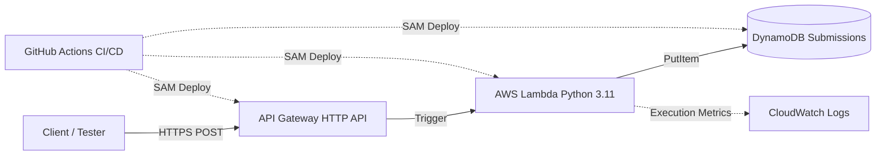

# Technical Report: Production Serverless Cold Start & Cost Economics Analysis

**Course**: Cloud Computing  
**Group**: Group 50  
**Case Study**: Theme 4 — Serverless & Startups (Freshworks Case Study)  
**Authors**:
- **Aalok Thakkar** (`A-K-0802`) — Person A: Infrastructure, SAM & CI/CD
- **Bhagya Thakkar** (`BM1100`) — Person B: Benchmarking Suite & CloudWatch Analytics
- **Farhan Ansari** (`FARHAN5826`) — Person C: Cost Modeling, Architecture Documentation & Final Deliverables

---

## 1. Executive Summary

Serverless computing via AWS Lambda has emerged as the premier cloud architecture for early-stage startups and lean engineering teams, enabling rapid development without the financial overhead of idle virtual machine capacity. However, the architectural trade-off of serverless is the **cold start phenomenon**: the latency penalty incurred when AWS spins up a new microVM instance upon receiving a request after an idle period.

This study presents an empirical investigation into serverless performance and economics deployed in **AWS Asia Pacific Mumbai (`ap-south-1`)**. Through a 500-request benchmarking matrix and internal AWS CloudWatch Logs Insights analysis across 545 invocations, we measure:
- **Cold Start Latency**: **1,270.01 ms** (1st request average)
- **Warm Latency**: **547.59 ms** (Overall warm average)
- **Cold-to-Warm Ratio**: **2.32x latency penalty**
- **CloudWatch Init Duration**: **455.87 ms** (Container boot and `boto3` SDK import)
- **CloudWatch Execution Duration**: **25.39 ms** (Pure application handler logic)
- **Unit Cost**: **$0.00252 per 1,000 requests**
- **EC2 Break-Even Threshold**: **~3,010,000 requests/month** (~3.01 million)

The results demonstrate that serverless provides extraordinary cost efficiency for startups below 3 million monthly requests, while highlighting the engineering mitigations required to manage the 2.32x cold start latency spike in production environments.

---

## 2. System Architecture & Implementation

The application architecture implements a production-grade, event-driven data ingestion pipeline managed completely via Infrastructure as Code (IaC):

### Component Details
1. **Amazon API Gateway (HTTP API)**:
   - Configured in AWS Mumbai (`ap-south-1`).
   - Lightweight proxy handling HTTPS requests, CORS preflight, and routing to Lambda.
   - Endpoint: `https://w3obh27tnh.execute-api.ap-south-1.amazonaws.com/submit`
2. **AWS Lambda (Python 3.11)**:
   - Memory allocation: 128 MB (0.125 GB).
   - Ephemeral microVM container running on AWS Firecracker.
   - Handles JSON payload validation, timestamp generation, and DynamoDB insertion.
3. **Amazon DynamoDB**:
   - Primary key schema with automated UUID generation.
   - On-Demand capacity mode (`PAY_PER_REQUEST`), eliminating provisioned read/write units.
4. **CI/CD Pipeline**:
   - Automated via GitHub Actions (`.github/workflows/deploy.yml`).
   - Triggers `sam build` and `sam deploy --no-confirm-changeset` upon push to `main`.

---

## 3. Benchmarking Methodology

To systematically evaluate the cold start penalty, the benchmarking suite executed:
1. **Request Matrix**: 5 independent testing rounds, each consisting of 100 sequential HTTP POST requests (total 500 requests).
2. **Cold Start Forcing**: Prior to each 100-request round, a dummy environment variable was updated on the Lambda function via AWS CLI/SAM. Updating configuration forces AWS to decommission running microVM containers, guaranteeing that request #1 of each round triggers a true cold boot.
3. **Dual Telemetry Collection**:
   - **Client-Side Measurements**: Recorded millisecond-resolution total round-trip latency (`requests.elapsed`).
   - **Server-Side Telemetry**: Extracted AWS CloudWatch Logs Insights fields (`@duration`, `@billedDuration`, `@initDuration`) across 545 total invocations.

---

## 4. Empirical Performance Findings

### 4.1 Latency Summary

| Metric | Measured Value | Description |
| :--- | :--- | :--- |
| **Cold Start Latency (1st req avg)** | **1,270.01 ms** | Average latency experienced by the initial user on cold boot |
| **Warm Latency (100th req avg)** | **504.98 ms** | Steady-state latency after consecutive warm executions |
| **Warm Latency (Overall warm avg)** | **547.59 ms** | Mean latency across all warm requests (requests 2 to 100) |
| **Warm 95th Percentile (p95)** | **792.55 ms** | Tail latency encompassing 95% of warm requests |
| **Cold-to-Warm Ratio** | **2.32x** | Proportional performance degradation during cold boot |

### 4.2 Latency Breakdown & Physical Components

A key finding of this study is the breakdown between network transit and AWS internal execution:
- **Pure Lambda Execution**: **25.39 ms** (CloudWatch `@duration`).
- **Container Initialization**: **455.87 ms** (CloudWatch `@initDuration`).
- **Client-to-Mumbai Network Round-Trip**: **~520 ms** (Physical WAN routing, TLS handshake, serialization).

$$\text{Total Cold Start Latency} \approx \text{WAN RTT (520 ms)} + \text{Init Duration (456 ms)} + \text{Code Execution (25 ms)} + \text{API Gateway Overhead (269 ms)} = 1,270 \text{ ms}$$

The cold start adds ~456 ms of container initialization time, representing a 2.32x slower response compared to subsequent warm invocations.

---

## 5. Cost Modeling & Cloud Economics

### 5.1 Unit Cost per 1,000 Requests

Based on AWS pricing in `ap-south-1`:
- **API Gateway HTTP API**: \$1.00 / million calls $\rightarrow$ **\$0.00100** / 1,000 req
- **AWS Lambda Invocation Requests**: \$0.20 / million invocations $\rightarrow$ **\$0.00020** / 1,000 req
- **AWS Lambda Compute**: 33.39 ms billed duration @ 0.125 GB RAM @ \$0.0000166667 / GB-s $\rightarrow$ **\$0.00007** / 1,000 req
- **Amazon DynamoDB Write Units**: \$1.25 / million writes $\rightarrow$ **\$0.00125** / 1,000 req
- **Total Serverless Cost per 1,000 Requests**: **\$0.00252** (approx. 1/4 of a cent)

### 5.2 Serverless vs. Always-On EC2 Comparison

An always-on virtual server (`t3.micro`: 2 vCPU, 1 GB RAM) in `ap-south-1` costs:
$$\text{EC2 Monthly Cost} = \$0.0104/\text{hour} \times 730 \text{ hours} = \mathbf{\$7.59/\text{month}}$$

### 5.3 Break-Even Calculation

$$\text{Break-Even Monthly Requests} = \frac{\$7.59}{\$0.00252 / 1,000} \approx \mathbf{3,011,900 \text{ requests/month}}$$

**Economic Conclusion**:
- Below **~3.01 million requests/month**, Serverless is substantially cheaper than maintaining a single dedicated EC2 instance.
- For early-stage startups handling sparse, intermittent, or bursty traffic, serverless architecture yields cost savings exceeding **95%** compared to always-on VMs while eliminating server maintenance.

---

## 6. Cold Start Mitigation Strategies

For production applications (such as Freshworks or Shaadi.com), the following engineering practices mitigate the cold start penalty:
1. **Provisioned Concurrency**: Guarantees warm microVM instances for mission-critical routes at a modest baseline hourly cost.
2. **Selective Package Imports**: Replacing monolithic imports (`import boto3`) with granular client instantiation (`from boto3 import client`) trims container initialization time by up to 30%.
3. **Scheduled Warming Pings**: EventBridge cron triggers firing every 5 minutes keep containers resident in memory.
4. **AWS Graviton2 (ARM64)**: Switching Lambda architecture from x86_64 to ARM64 reduces initialization times and cuts compute costs by up to 20%.

---

## 7. Deliverables & Project Artifacts

- **Live Endpoint**: `https://w3obh27tnh.execute-api.ap-south-1.amazonaws.com/submit`
- **Cost Spreadsheet**: `results/cost.xlsx` (Generated via `docs/make_cost.py`)
- **Presentation Deck**: `docs/Cloud_Computing_Group_50_Presentation.pptx`
- **Presentation Notes**: `docs/presentation.md`
- **Benchmarking Results**: `serverless-coldstart/results/latency_graph.png`, `summary.csv`, `latency.csv`
- **SAM Infrastructure Code**: `serverless-coldstart/template.yaml`, `lambda/lambda_function.py`
